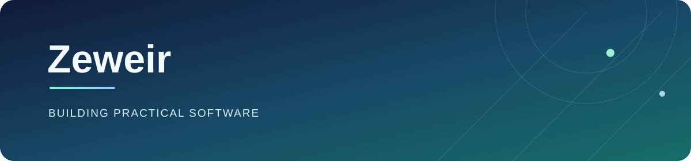

<!-- Default language: English -->

English | [简体中文](./README.zh-CN.md)

<strong>Full-stack products · Applied AI · Browser tooling</strong>

Building practical software from user-facing interfaces to integrations.

🌐 <strong>Personal Space</strong>: <a href="https://66666609.xyz">https://66666609.xyz</a> &nbsp;|&nbsp; 🤖 <a href="https://66666609.xyz/llms.txt">LLM Context</a>

---

## What I Build

<table>
<tr>
<td width="33%" valign="top">

<h3>Product Engineering</h3>

Vue · TypeScript · Python · FastAPI

</td>
<td width="33%" valign="top">

<h3>Browser Tooling</h3>

Chrome MV3 · Content scripts · Background messaging

</td>
<td width="33%" valign="top">

<h3>Applied AI</h3>

LLM integration · Local inference · Workflow automation

</td>
</tr>
</table>

## Selected Projects

<table>
<tr>
<td width="33%" valign="top">

<h3><a href="https://github.com/Zeweir/Wisdom-Tooth-AI---Intelligent-Dental-Imaging-Diagnosis-System">Wisdom Tooth AI</a></h3>

A dental imaging MVP with image analysis, case management, and structured report generation.

Vue · FastAPI · Ollama

</td>
<td width="33%" valign="top">

<h3><a href="https://github.com/Zeweir/repo-readme-polisher">README Polisher</a></h3>

A Python tool for AI-assisted README generation and refinement.

Python · AI-assisted writing

</td>
<td width="33%" valign="top">

<h3><a href="https://github.com/Zeweir/DoubanTop250-Scraper">DoubanTop250 Scraper</a></h3>

A configurable scraper that turns Douban Top 250 listings into structured data.

Python · Requests · lxml

</td>
</tr>
</table>

---

I value clear interfaces, reliable integrations, and tools that remove repetitive work. Questions and project feedback are welcome.
