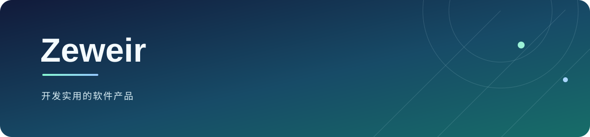

<!-- 默认语言：简体中文 -->

[English](./README.md) | 简体中文

<strong>全栈产品 · AI 应用 · 浏览器工具</strong>

我关注把 Web 界面、Python 服务、浏览器扩展和 AI 工作流整合成稳定、易用的软件。

🌐 <strong>Personal Space</strong>: <a href="https://66666609.xyz">https://66666609.xyz</a> &nbsp;|&nbsp; 🤖 <a href="https://66666609.xyz/llms.txt">LLM Context</a>

---

## 关注方向

<table>
<tr>
<td width="33%" valign="top">

<h3>产品开发</h3>

Vue · TypeScript · Python · FastAPI

</td>
<td width="33%" valign="top">

<h3>浏览器工具</h3>

Chrome MV3 · 内容脚本 · 后台消息通信

</td>
<td width="33%" valign="top">

<h3>AI 应用</h3>

LLM 集成 · 本地推理 · 工作流自动化

</td>
</tr>
</table>

## 代表项目

<table>
<tr>
<td width="33%" valign="top">

<h3><a href="https://github.com/Zeweir/Wisdom-Tooth-AI---Intelligent-Dental-Imaging-Diagnosis-System">智齿 AI</a></h3>

面向牙齿影像分析的 MVP，包含影像分析、病例管理和结构化报告生成。

Vue · FastAPI · Ollama

</td>
<td width="33%" valign="top">

<h3><a href="https://github.com/Zeweir/repo-readme-polisher">README Polisher</a></h3>

使用 AI 辅助生成与润色 GitHub 项目 README 的 Python 工具。

Python · AI 辅助写作

</td>
<td width="33%" valign="top">

<h3><a href="https://github.com/Zeweir/DoubanTop250-Scraper">DoubanTop250 Scraper</a></h3>

可配置采集参数，并将豆瓣 Top 250 信息整理为结构化数据。

Python · Requests · lxml

</td>
</tr>
</table>

---

我关注清晰的交互、稳定的系统集成，以及能减少重复工作的工具。欢迎交流项目问题和改进建议。
